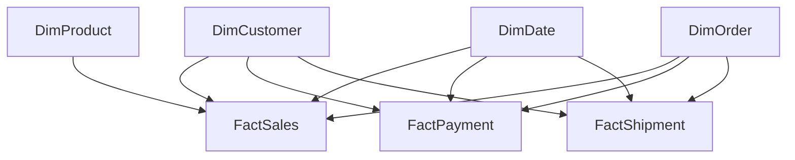

# E-Commerce Analytics & Data Warehouse

## 1. Project Overview

### Purpose

The purpose of this project is to design and implement an end-to-end data analytics platform for a fictional e-commerce business. The project covers data generation, data quality processing, dimensional data modelling, SQL Server implementation, and interactive reporting in Power BI.

The data warehouse follows a **Galaxy Schema (Fact Constellation)**, separating sales, payment, and shipment processes into distinct fact tables while using shared dimensions where appropriate.

This self-initiated portfolio project demonstrates practical skills in:

- **SQL & Data Warehousing** — dimensional modelling and Galaxy Schema design
- **Python** — synthetic data generation, data processing, and data quality checks
- **Data Quality & Validation** — validation rules, anomaly handling, and integrity checks
- **Power BI** — data modelling, KPI reporting, and interactive dashboards
- **Business Analysis** — translating business questions into analytical requirements

## 2. Business Scenario

A fictional international e-commerce company sells consumer products across multiple markets and sales channels. Its operational processes generate data related to customer orders, payments, and shipments.

Analysing these processes in a single flat data model can lead to duplicated records and incorrect aggregations because each process operates at a different level of detail.

The goal of this project is to create a structured analytical data warehouse that preserves the granularity of each business process and supports consistent reporting across sales, payments, shipments, customers, and products.

## 3. Business Objectives

- **Process Separation:** Model sales, payments, and shipments at their respective levels of detail.
- **Consistent Analysis:** Use shared dimensions where appropriate to support cross-process reporting.
- **Sales Performance:** Analyse revenue, order volumes, and sales trends over time.
- **Product Analysis:** Compare product and category performance.
- **Payment Analysis:** Examine payment amounts, methods, and statuses.
- **Logistics Analysis:** Explore shipment volumes and delivery duration.
- **Customer Analysis:** Investigate customer and segment-level sales patterns.
- **Data Quality:** Apply validation rules and checks before using the data for reporting.

## 4. Key Business Questions

| Area | Business Questions |
|---|---|
| Sales | How does revenue develop over time? Which periods generate the highest sales? |
| Products | Which products and categories contribute most to revenue? |
| Payments | How are payment amounts and payment statuses distributed? |
| Shipments | What are the observed delivery durations? |
| Customers | How does revenue vary across customer segments and countries? |
| Sales Channels | How does sales performance differ across available channels? |
| Data Quality | Which data quality issues occur, and how are they handled? |

These questions provide the analytical direction for the project. The extent to which each question is currently answered depends on the implemented SQL queries and Power BI measures.

## 5. Key Performance Indicators (KPIs)

The project dashboard includes KPI cards for the following measures:

- **Total Revenue** — total sales revenue represented in the sales data.
- **Total Orders** — number of distinct orders.
- **Total Customers** — number of customers represented in the data.
- **Units Sold** — total quantity of products sold.
- **Payment Amount** — total amount recorded in the payment data.
- **Average Delivery Duration** — average delivery time based on the available shipment data.

Additional KPIs, such as Average Order Value (AOV), payment settlement rate, on-time delivery rate, gross profit margin, and year-over-year revenue growth, may be added if the required measures and data are implemented and validated.

## 6. Data Warehouse Architecture

The data warehouse follows a Galaxy Schema design with three fact tables and four shared dimension tables.

### Fact Tables

- **FactSales:** Sales transactions at order-line level.
- **FactPayment:** Payment transactions at payment level.
- **FactShipment:** Shipment records at shipment level.

### Dimension Tables

- **DimCustomer:** Customer-related attributes.
- **DimProduct:** Product-related attributes.
- **DimDate:** Date attributes for time-based analysis.
- **DimOrder:** Order-related attributes.

This structure supports the analysis of sales, payments, and shipments at their respective levels of detail.

## 7. Data Quality & Validation

Data quality is an important part of the project workflow.

The project uses synthetic source data containing deliberately introduced data quality issues. Python-based processing addresses identified issues, while SQL scripts support technical validation of the data warehouse.

Validation includes checks such as:

- Expected row counts
- Duplicate key detection
- Unknown dimension members
- Key and referential integrity checks

These checks help assess whether the processed data is suitable for analytical reporting.

## 8. Tools & Technologies

- Python
- SQL Server
- SQL
- Power BI
- CSV data exchange

## 9. Future Development

The project is designed as a foundation for further development. Planned enhancements include integrating data from additional sources, expanding the data ingestion workflow, introducing further data quality rules, and extending the analytical capabilities of the Power BI dashboard.

The long-term goal is to develop the project into a more comprehensive analytics solution covering the workflow from data ingestion and data quality assurance to data warehousing, reporting, and business insights.

## 10. Disclaimer

This project uses synthetic e-commerce data for educational and portfolio purposes. It does not represent actual company transactions or real customer records.
