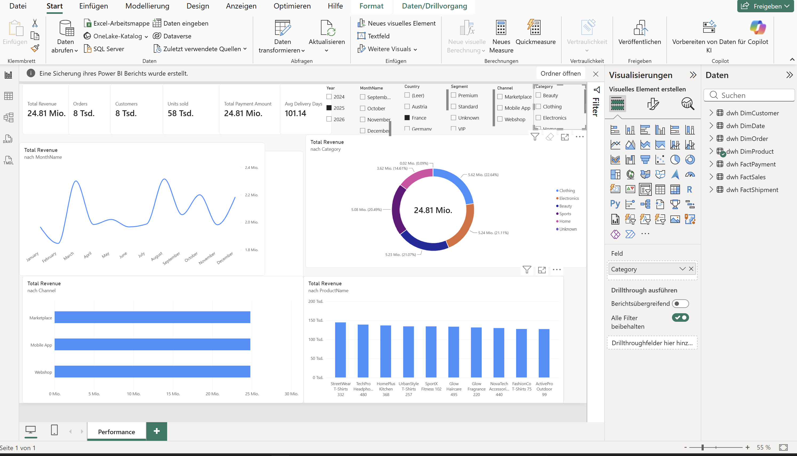

# E-Commerce Analytics & Data Warehouse

An end-to-end data analytics portfolio project demonstrating data quality processing, dimensional data modelling, SQL Server data warehousing, and interactive Power BI reporting for a fictional e-commerce business.

## Dashboard Preview

<!-- Replace the image path below with the exact screenshot filename in your repository. -->



## 1. Project Overview

This self-initiated project builds an analytical data warehouse for a fictional international e-commerce company. It covers synthetic data generation, data quality processing, SQL Server implementation, technical validation, and Power BI reporting.

The warehouse follows a **Galaxy Schema (Fact Constellation)**, separating sales, payment, and shipment processes into distinct fact tables while sharing dimensions where appropriate.

### Skills Demonstrated

- **SQL & Data Warehousing:** dimensional modelling, SQL Server, fact and dimension tables
- **Python:** synthetic data generation and data processing
- **Data Quality:** data quality rules, unknown dimension members, and technical validation
- **Power BI:** KPI reporting, data modelling, and interactive dashboards
- **Business Analysis:** translating business questions into analytical requirements

## 2. Business Scenario

The fictional company sells consumer products across multiple countries and sales channels. Its operations generate customer, order, sales, payment, and shipment data.

Combining these processes without respecting their different levels of detail can cause duplicated records and incorrect aggregations. The project therefore separates each process into its own fact table and uses shared dimensions to support consistent analysis.

## 3. Business Questions

The project is designed to explore questions such as:

- How does sales revenue change over time?
- Which products and categories contribute most to revenue?
- How do sales vary by country, customer segment, and channel?
- How are payment amounts, methods, and statuses distributed?
- What delivery durations are observed in the shipment data?
- How are data quality issues identified and handled?

The extent to which each question is answered depends on the implemented measures and report visuals.

## 4. Data Warehouse Architecture

The warehouse contains three fact tables and four dimension tables.

### Fact Tables

| Table | Grain |
|---|---|
| `FactSales` | One row per order line |
| `FactPayment` | One row per payment transaction |
| `FactShipment` | One row per shipment record |

### Dimension Tables

| Table | Purpose |
|---|---|
| `DimCustomer` | Customer attributes |
| `DimProduct` | Product attributes |
| `DimDate` | Calendar attributes for time-based analysis |
| `DimOrder` | Order attributes |

### Logical Model

```text
DimCustomer ──┬── FactSales ──── DimProduct
              ├── FactPayment
              └── FactShipment

DimOrder ────── FactSales
           ├─── FactPayment
           └─── FactShipment

DimDate ─────── FactSales
           ├─── FactPayment
           └─── FactShipment
```

This diagram illustrates the intended logical relationships. It does not imply that physical foreign-key constraints are defined in SQL Server.

## 5. Project Results

The following row counts were observed during database validation.

| Table | Observed Rows |
|---|---:|
| `DimCustomer` | 10,001 |
| `DimProduct` | 501 |
| `DimDate` | 5,844 |
| `DimOrder` | 100,000 |
| `FactSales` | 299,131 |
| `FactPayment` | 100,000 |
| `FactShipment` | 94,974 |

The date dimension covers **1 January 2020 through 31 December 2035**.

These figures describe the observed warehouse contents. They do not, by themselves, establish that every data quality check passed.

## 6. Power BI Dashboard

The dashboard includes KPI cards for:

- **Total Revenue**
- **Total Orders**
- **Total Customers**
- **Units Sold**
- **Payment Amount**
- **Average Delivery Duration**

The report also includes analysis of revenue by month, product category, sales channel, and product, with filters for dimensions such as year, month, country, customer segment, channel, and category.

Additional metrics, including Average Order Value, settlement rate, on-time delivery rate, gross profit margin, and year-over-year revenue growth, are potential future enhancements unless explicitly implemented and validated.

## 7. Data Quality & Validation

The project uses synthetic source data with deliberately introduced data quality issues.

Python-based processing addresses identified issues, and SQL validation scripts check the warehouse structure and data.

Validation includes:

- Expected row counts
- Duplicate business keys and fact-grain duplicates
- Unknown dimension members
- Fact-to-dimension key relationships
- Date-key validity
- Negative or otherwise suspicious measure values
- Selected intentional data quality cases

The validation scripts report results for review; successful execution of a script does not necessarily mean every individual check passed.

## 8. Repository Guide

Explore the project using the following sections:

- [Business Requirements & Documentation](./01_documentation/01_business_requirements/)
- [SQL Scripts](./02_scripts/)
- [Power BI Reports & Dashboards](./03_Power_BI_Reports_Dashboards/)

The documentation covers business requirements, data architecture and dimensional modelling, the data dictionary, and the ETL and data quality framework.

## 9. Tools & Technologies

- Python
- SQL Server
- SQL
- Power BI
- CSV

## 10. Limitations & Future Development

This project is a portfolio demonstration using synthetic data. Its results should not be interpreted as real business performance.

Potential future improvements include expanding data ingestion, adding further data quality rules, implementing additional validated KPIs, and extending the reporting capabilities.

## 11. Disclaimer

All data used in this project is synthetic and intended for educational and portfolio purposes. It does not represent actual company transactions or real customer records.
